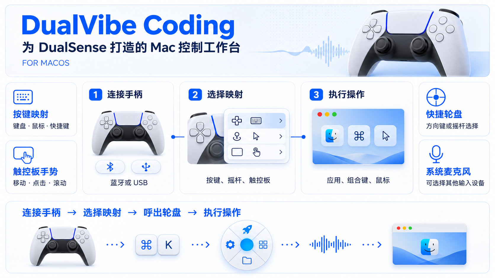
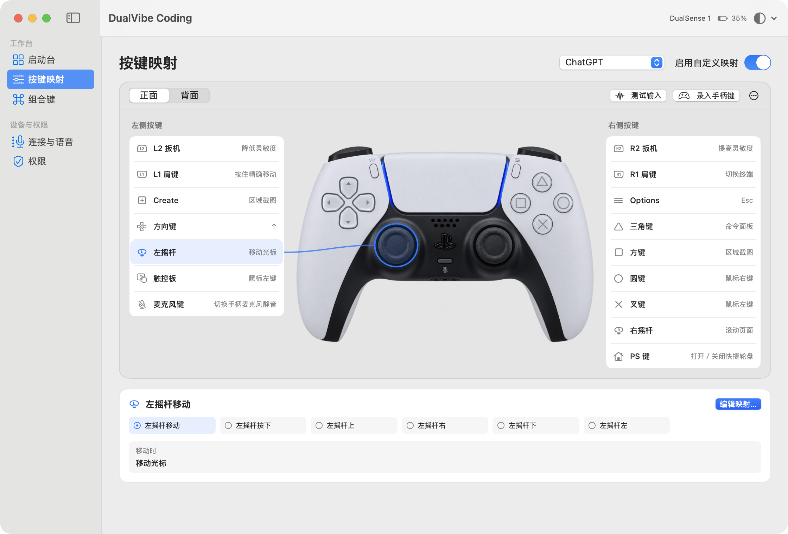

# DualVibe Coding

[中文](README.md)

<p align="center">
  <a href="https://github.com/ruaomol/DualVibe-Coding/releases"></a>
  <a href="https://github.com/ruaomol/DualVibe-Coding"></a>
  <a href="LICENSE"></a>
  <a href="https://github.com/ruaomol/DualVibe-Coding/stargazers"></a>
</p>

<p align="center">
  <a href="https://github.com/ruaomol/DualVibe-Coding/releases">Downloads and releases</a> ·
  <a href="docs/DEMO.md">Demo flow</a> ·
  <a href="https://github.com/ruaomol/DualVibe-Coding/issues">Report an issue</a>
</p>

<p align="center">
  
</p>

<p align="center">
  
</p>

<p align="center">
  
</p>

**DualVibe Coding: a Mac buddy, a coding helper, and smoother to use.**

**Control at hand, act as you please. Your next coding device doesn't have to be a keyboard and mouse.**

DualVibe Coding is a macOS app that turns a DualSense into a mouse, keyboard, microphone, and launcher. It starts by making controller input immediately usable, then connects touchpad gestures, button mappings, a radial launcher, and per-app setups.

DualVibe Coding is built natively with SwiftUI. It can connect more than one DualSense over Bluetooth or USB, and shows battery and charging status at a glance.

## Video demo

<p align="center">
  <a href="docs/video/dualvibe-demo.mp4">
    
  </a>
</p>

<p align="center"><a href="docs/video/dualvibe-demo.mp4">Click the cover to watch the interface demo</a></p>

## DualVibe Coding, a Mac buddy

<table>
  <tr>
    <td align="center" width="33%">
      <br>
      <strong>Buttons you can remap</strong><br>
      Give every app its own mapping
    </td>
    <td align="center" width="33%">
      <br>
      <strong>Controller and voice</strong><br>
      Connect devices and manage voice input
    </td>
    <td align="center" width="33%">
      <br>
      <strong>Permissions at a glance</strong><br>
      Follow the prompts and get started
    </td>
  </tr>
</table>

### Touchpad as a mouse

Move the pointer, click, double-click, right-click, drag, scroll, and switch desktops. Stick output can stay continuous while you hold buttons, which makes dragging and holding more reliable.

### Buttons you can remap

Map buttons to keys, mouse clicks, holds, or shortcut combinations. Each app can have its own mappings, and conflicts show up right on the slot they affect.

### A wheel that opens apps

The radial launcher can open apps, run combos, or fire mapped actions. Steer it with the D-pad or a stick. Drag a `.app` from Finder straight into the app library.

It also supports light, dark, or system appearance, and the window comes back as it was after you reactivate it.

## What you need

- macOS 14 or later
- A DualSense controller
- Accessibility and Input Monitoring permissions if you want mouse, keyboard, touchpad, or shortcut output
- Microphone permission if you want voice input

## Install

When a build is released, its `DualVibe-Coding-*.dmg` will be available from [GitHub Releases](https://github.com/ruaomol/DualVibe-Coding/releases). Open the disk image, drag the app to Applications, then open the **Permissions** page on first launch. Grant what macOS asks for and hit **Recheck**.

<details>
<summary><strong>Show first-launch and permission steps</strong></summary>

1. Open the app's **Permissions** page and review Accessibility, Input Monitoring, and Microphone status.
2. Click the button beside each missing permission and follow the macOS System Settings prompt.
3. Return to DualVibe Coding, click **Recheck**, and confirm that the status is granted.
4. Accessibility and Input Monitoring are enough for button mappings. Enable Microphone when you want voice input.

</details>

<p align="center">
  
</p>

## Build from source

```sh
brew install opus
./scripts/build-app.sh
./scripts/package-dmg.sh
```

Build outputs stay in local `.build/` and `dist/` folders, and they are not part of the public repo. The app keeps a stable bundle identifier and a persistent signing identity, so your macOS permission grants can survive updates.

See [docs/DEMO.md](docs/DEMO.md) for the demo flow. The interface demo is available at [docs/video/dualvibe-demo.mp4](docs/video/dualvibe-demo.mp4).

## Privacy and sources

This repository contains source code, build scripts, required third-party notices, and public documentation. Personal mappings, app paths, signing keys, build caches, screenshots, and test records stay out of the public repo.

The project draws on [Agent Remote](https://github.com/AbhisekBasu1/agent-remote) for DualSense input and touchpad ideas, [remote-mic-app](https://github.com/HD838A/remote-mic-app) for the microphone approach, and [StarPie](https://github.com/Star-Pie/StarPie) for the controller wheel.

## License

DualVibe Coding is released under the [MIT License](LICENSE). Third-party licenses and notices are bundled with the app and kept in `ThirdParty/AgentRemote`.

## Community

Questions, or just want to talk about how you use it? Join the DualVibe Coding group.

<p align="center">
  
</p>
