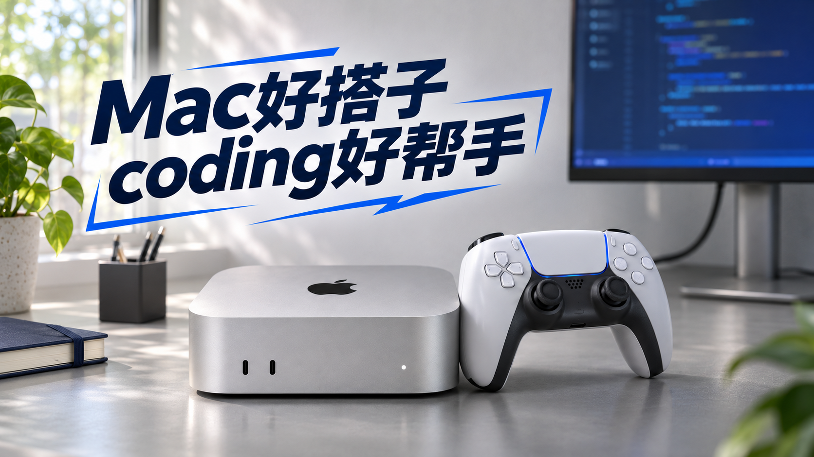
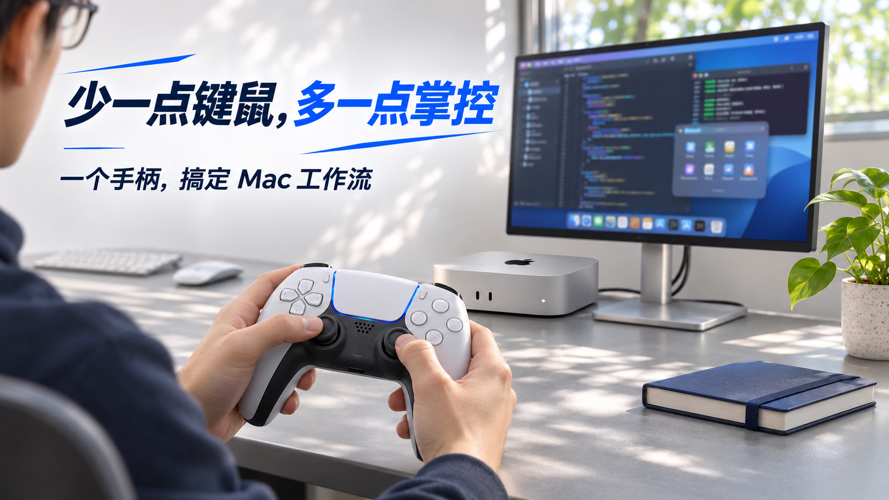
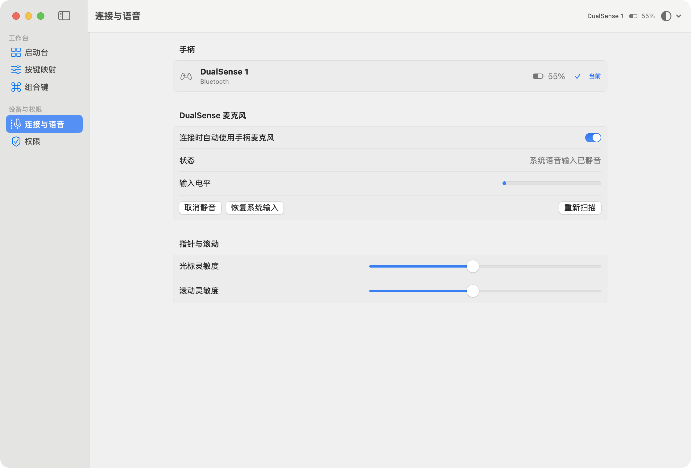
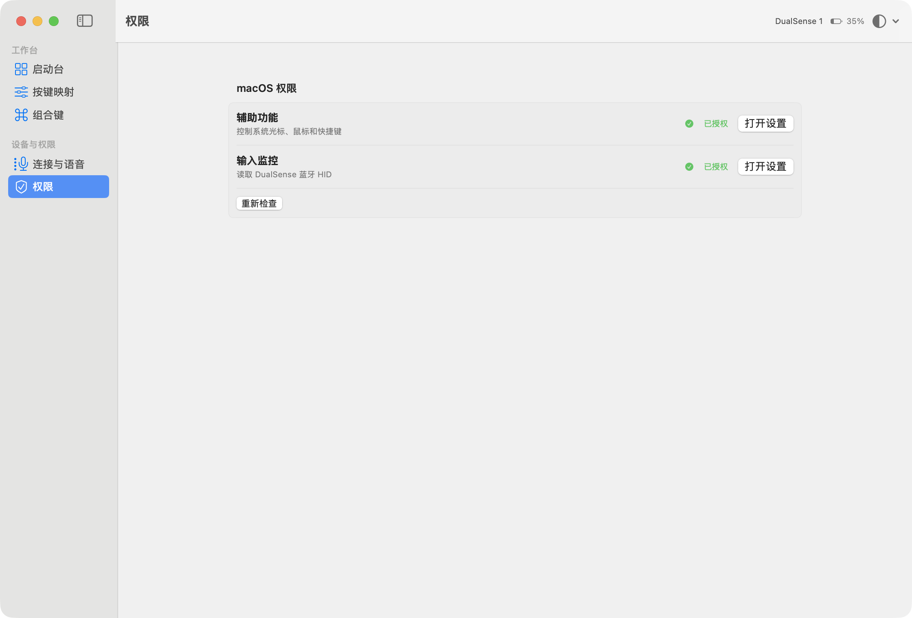

# DualVibe Coding

[中文](README.md)






**DualVibe Coding: a Mac buddy, a coding helper, and smoother to use.**

**Touchpad as a mouse. Buttons you can remap. A wheel that opens apps.**

DualVibe Coding is a macOS app that turns a DualSense into a mouse, keyboard, microphone, and launcher. It starts by making controller input immediately usable, then connects touchpad gestures, button mappings, a radial launcher, and per-app setups.

DualVibe Coding is built natively with SwiftUI. It can connect more than one DualSense over Bluetooth or USB, and shows battery and charging status at a glance.



## DualVibe Coding, a Mac buddy

### Touchpad as a mouse

Move the pointer, click, double-click, right-click, drag, scroll, and switch desktops. Stick output can stay continuous while you hold buttons, which makes dragging and holding more reliable.

### Buttons you can remap

Map buttons to keys, mouse clicks, holds, or shortcut combinations. Each app can have its own mappings, and conflicts show up right on the slot they affect.

### A wheel that opens apps

The radial launcher can open apps, run combos, or fire mapped actions. Steer it with the D-pad or a stick. Drag a `.app` from Finder straight into the app library.

It also supports light, dark, or system appearance, and the window comes back as it was after you reactivate it.

## What you need

- macOS 14 or later
- A DualSense controller
- Accessibility and Input Monitoring permissions if you want mouse, keyboard, touchpad, or shortcut output
- Microphone permission if you want voice input

## Install

A `DualVibe-Coding-*.dmg` will be available from GitHub Releases. Open it and drag the app to Applications. The first time you launch it, go to the Permissions page, grant what macOS asks for, then come back and hit Recheck.



## Build from source

```sh
brew install opus
./scripts/build-app.sh
./scripts/package-dmg.sh
```

Build outputs stay in local `.build/` and `dist/` folders, and they are not part of the public repo. The app keeps a stable bundle identifier and a persistent signing identity, so your macOS permission grants can survive updates.

See [docs/DEMO.md](docs/DEMO.md) for the demo flow.

UI demo video: [dualvibe-demo.mp4](docs/video/dualvibe-demo.mp4)

## Sources

This project draws on [Agent Remote](https://github.com/AbhisekBasu1/agent-remote) for DualSense input and touchpad ideas, [remote-mic-app](https://github.com/HD838A/remote-mic-app) for the microphone approach, and [StarPie](https://github.com/Star-Pie/StarPie) for the controller wheel.

## License

DualVibe Coding is released under the MIT License. Third-party licenses and notices are bundled with the app and kept in `ThirdParty/AgentRemote`.

## Community

Questions, or just want to talk about how you use it? Join the DualVibe Coding group.


