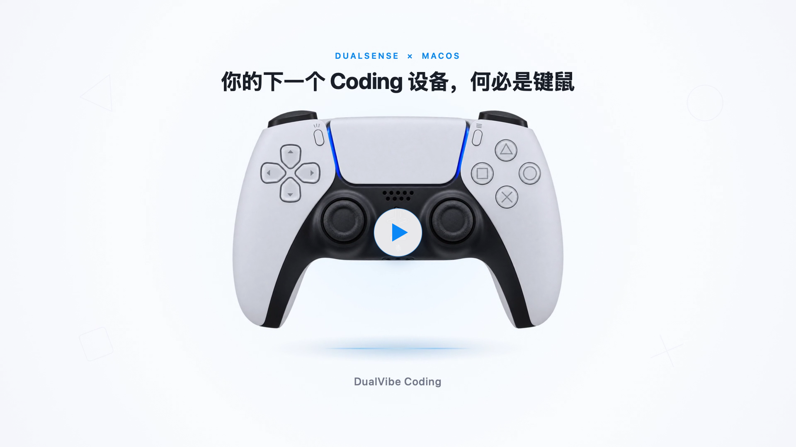
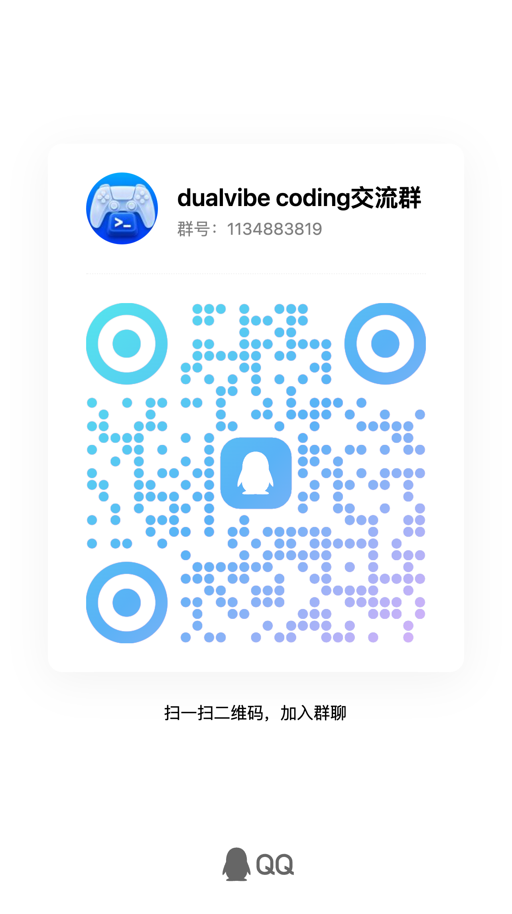

# DualVibe Coding

[中文](README.md)

[Download DMG](https://github.com/ruaomol/DualVibe-Coding/releases) · [AI Install Guide](docs/guides/AI-INSTALL.md) · [Issues](https://github.com/ruaomol/DualVibe-Coding/issues)

<p>
  <a href="https://github.com/ruaomol/DualVibe-Coding/releases"></a>
  <a href="LICENSE"></a>
  <a href="https://github.com/ruaomol/DualVibe-Coding/stargazers"></a>
</p>

## Video

A 24-second film showing how DualVibe Coding turns PlayStation's DualSense into a natural way to steer your Mac, launch apps, and stay in flow while vibe coding.

<p align="center">
  <a href="docs/assets/video/dualvibe-promo.mp4">
    
  </a>
</p>

<p align="center">
  <a href="docs/assets/video/dualvibe-promo.mp4">Click cover to watch the full video</a>
</p>

<p align="center">
  
</p>

**DualVibe Coding: a Mac buddy, a coding helper, and smoother to use.**

**Control at hand, act as you please. Your next coding device doesn't have to be a keyboard and mouse.**

<p align="center">
  
</p>

DualVibe Coding is a native macOS app that turns a DualSense into a precision mouse, keyboard, wireless microphone, and radial app launcher. It starts by making controller input immediately usable, then connects touchpad gestures, button mappings, combos, a radial wheel, and per-app setups.

Built natively with SwiftUI and AppKit, DualVibe Coding supports light, dark, and system appearances as well as instant **English / Simplified Chinese** language switching (available directly in **Permissions**). Its latency-critical anti-App Nap engine and 120Hz high-precision event scheduler keep pointer movement, clicks, and stick output smooth even while running in the background. Connect multiple DualSense controllers over Bluetooth or USB simultaneously and view live battery and charging status at a glance.

## DualVibe Coding, a Mac buddy

### One controller, one connected workflow

Connect your controller, customize mappings, open the radial wheel, and fire actions — all unified in a single native macOS workspace.

<p align="center">
  
</p>

### Touchpad as a mouse

Move the pointer, click, double-click, right-click, drag, scroll, and swipe across macOS Spaces. With 120Hz high-precision stick dispatch and background low-latency activity protection, clicks, dragging, and chords stay responsive without background stutter.

<p align="center">
  
</p>

### Remap every button

Switch smoothly between front and rear 3D DualSense views and customize every physical control:

- Configure **Tap, Double-Tap, and Hold** actions per button, plus optional "Hold Modifier" chords;
- Map to mouse clicks/holds, arbitrary keyboard shortcuts (including dedicated left/right `Shift`, `Control`, `Option`, `Command`, and `Fn`), launching apps, switching desktops, command palettes, terminals, or the radial wheel;
- Capture controls and modifiers directly from the physical controller, maintain per-app profiles, and spot conflicts inline.

<p align="center">
  
</p>

### A wheel that opens apps

Press `PS` anywhere to summon the 8-direction radial launcher at the screen center or pointer. Aim with either stick or the D-pad to launch apps, run combos, or trigger mapped shortcuts.

<p align="center">
  
</p>

### Drag-and-drop app library

Drag `.app` bundles straight from Finder into the App Library to search, launch, reorder, and toggle per-app mappings in one view.

<p align="center">
  
</p>

### Wireless voice & multi-controller management

Switch between multiple Bluetooth and USB DualSense controllers, monitor live battery status, select system or controller microphones with level metering, and tune cursor and scroll sensitivity.

<p align="center">
  
</p>

## Requirements

- macOS 14 or later
- DualSense controller (Bluetooth or USB-C)
- **Accessibility** and **Input Monitoring** permissions for pointer, keyboard, touchpad, and shortcut output
- **Microphone** permission for voice input

## Download & Install

The current release [DualVibe Coding v0.1.0](https://github.com/ruaomol/DualVibe-Coding/releases/tag/v0.1.0) ships as `DualVibe-Coding-0.1.0.dmg`. Open it, drag `DualVibe Coding.app` into `Applications`, open the **Permissions** page on first launch, grant macOS permissions, and click **Recheck**.

<p align="center">
  
</p>

## Build from source

```sh
brew install opus
./scripts/build-app.sh
./scripts/package-dmg.sh
```

Build outputs stay in local `.build/` and `dist/` folders. A stable bundle identifier and persistent local signing identity keep your macOS permission grants working across updates. See [docs/guides/DEMO.md](docs/guides/DEMO.md) for the public demo flow.

## Privacy & Sources

DualVibe Coding runs entirely locally on your Mac and never uploads your mappings, app catalog, voice audio, or Bluetooth identifiers.

This project draws inspiration from [Agent Remote](https://github.com/AbhisekBasu1/agent-remote), [remote-mic-app](https://github.com/HD838A/remote-mic-app), and [StarPie](https://github.com/Star-Pie/StarPie).

## ⭐ Star History

<p align="center">
  <a href="https://github.com/ruaomol/DualVibe-Coding/stargazers">
    
  </a>
</p>

## License

DualVibe Coding is released under the [MIT License](LICENSE). Third-party licenses and notices are bundled with the app and stored in `ThirdParty/AgentRemote`.

## Community

Have questions or want to share your DualSense × Vibe Coding setup? Join the community group.

<table>
  <tr>
    <td align="center">
      <a href="docs/assets/community/dualvibe-coding-group.jpg"></a><br>
      <strong>DualVibe Coding Group</strong><br>
      Scan with QQ to join
    </td>
  </tr>
</table>
