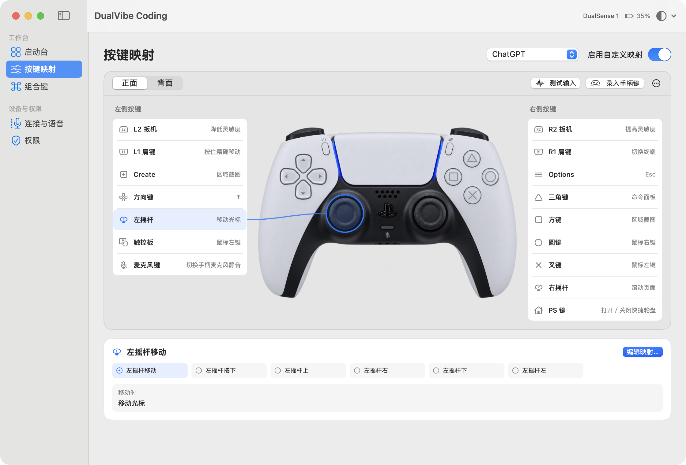
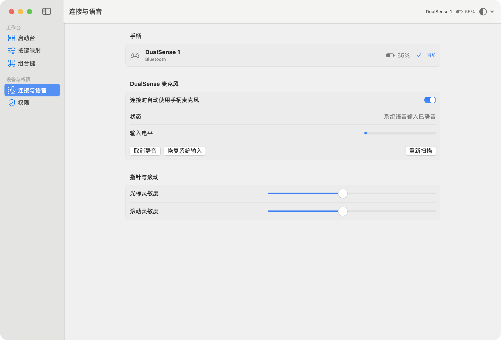
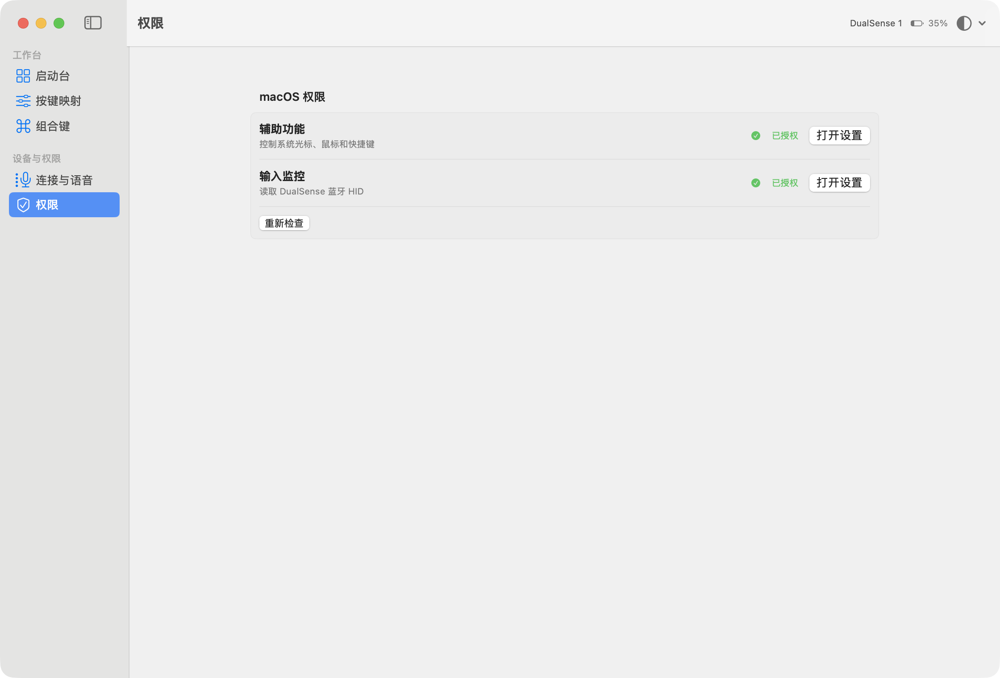
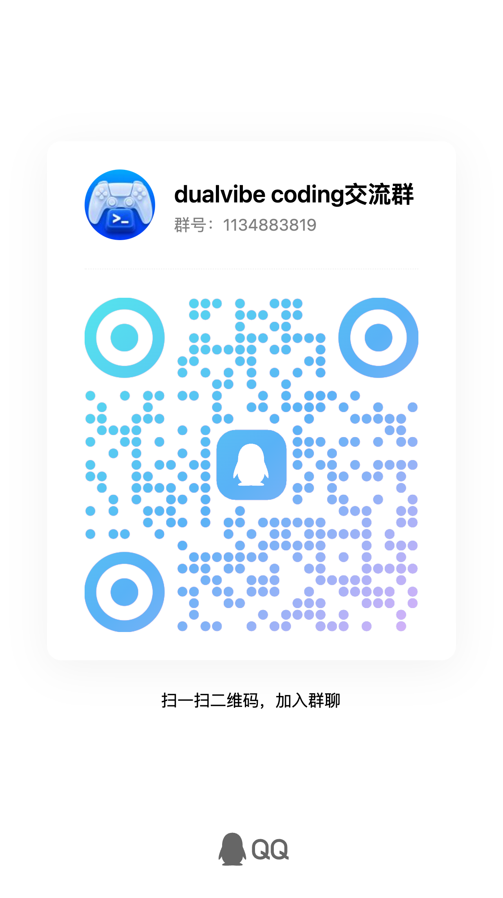

# DualVibe Coding

[English](README.en.md)



**DualVibe Coding，Mac 好搭子，Coding 好帮手，桌面更顺手。**

**触控板当鼠标，按键随你改，轮盘一键开。**

DualVibe Coding 是一款 macOS 应用，可以把 DualSense 变成鼠标、键盘、麦克风和启动器。它先让手柄输入马上能用，再把触控板手势、按键映射、快捷轮盘，以及每个 App 自己的方案连在一起。

DualVibe Coding 使用 SwiftUI 原生开发，支持蓝牙或 USB 同时连接多个 DualSense，电量和充电状态一眼能看到。



## DualVibe Coding，Mac 好搭子

### 触控板当鼠标

移动、单击、双击、右键、拖拽、滚动，还可以切桌面。摇杆可以持续输出，和按键一起用，拖拽、按住会更稳。

### 按键随你改

把按键映射成键盘、鼠标单击/双击/长按，或一套快捷键。每个 App 都能有自己的一套映射，冲突会标在对应位置上。

### 轮盘一键开

快捷轮盘能打开应用、跑组合键或执行映射动作，用方向键或摇杆就能选。应用库支持直接从访达把 `.app` 拖进来。

也支持浅色、深色，或跟随系统。窗口重新激活后，状态会自动恢复。

## 需要什么

- macOS 14 或更高版本
- DualSense 手柄
- 要用鼠标、键盘、触控板或快捷键时，请在系统设置里打开辅助功能和输入监控
- 要用语音输入时，打开麦克风权限

## AI 一键安装

不熟悉 macOS 设置时，可以复制 [AI 一键安装向导](docs/AI-INSTALL.md) 给聊天型或可操作电脑的 AI 助手。

## 安装

之后会在 GitHub Releases 提供 `DualVibe-Coding-*.dmg`。下载打开后，把应用拖进「应用程序」即可。第一次打开先到「权限」页，按提示完成系统授权，回到应用再点「重新检查」。



## 从源码构建

```sh
brew install opus
./scripts/build-app.sh
./scripts/package-dmg.sh
```

构建结果只会放在本地的 `.build/` 和 `dist/` 里，不会进公开仓库。应用使用固定的 Bundle Identifier 和长期有效的签名身份，所以升级之后，macOS 的辅助功能授权还可以继续用。

演示步骤见 [docs/DEMO.md](docs/DEMO.md)。

界面演示视频：[dualvibe-demo.mp4](docs/video/dualvibe-demo.mp4)

## 开源说明

这个仓库只放源代码、构建脚本、必要的第三方声明和公开文档。你的个人映射、应用路径、签名密钥、构建缓存，以及过程中的截图和测试记录，都不会上传。

项目里参考了 [Agent Remote](https://github.com/AbhisekBasu1/agent-remote) 的 DualSense 输入和触控板思路、[remote-mic-app](https://github.com/HD838A/remote-mic-app) 的麦克风方案，还有 [StarPie](https://github.com/Star-Pie/StarPie) 的手柄轮盘交互。

## 许可证

DualVibe Coding 使用 MIT License。第三方组件的许可证和声明会随应用一起打包，也保存在 `ThirdParty/AgentRemote`。

## 交流群

有问题，或者想聊聊用法，欢迎加入 DualVibe Coding 交流群。


