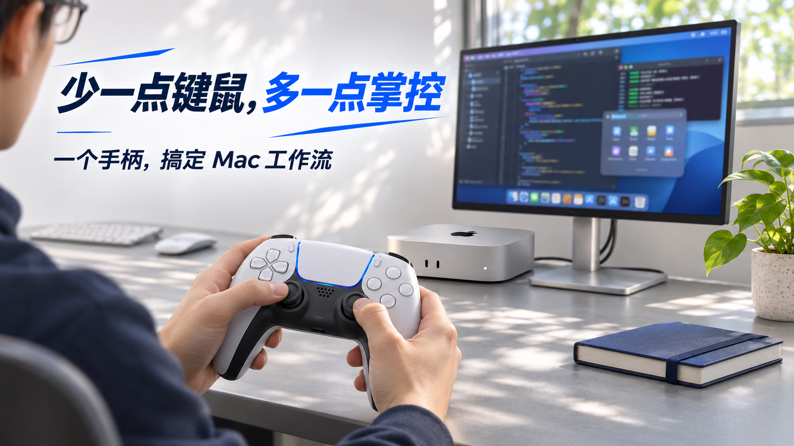
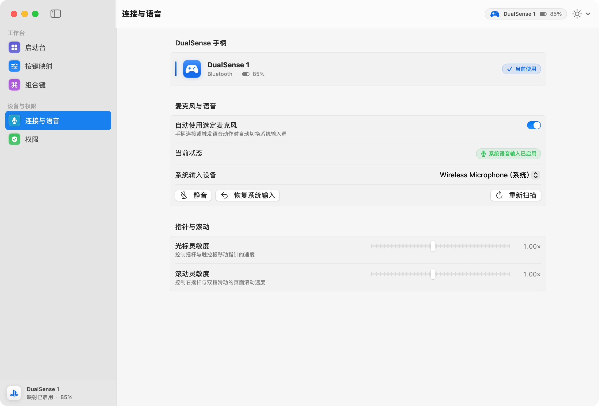
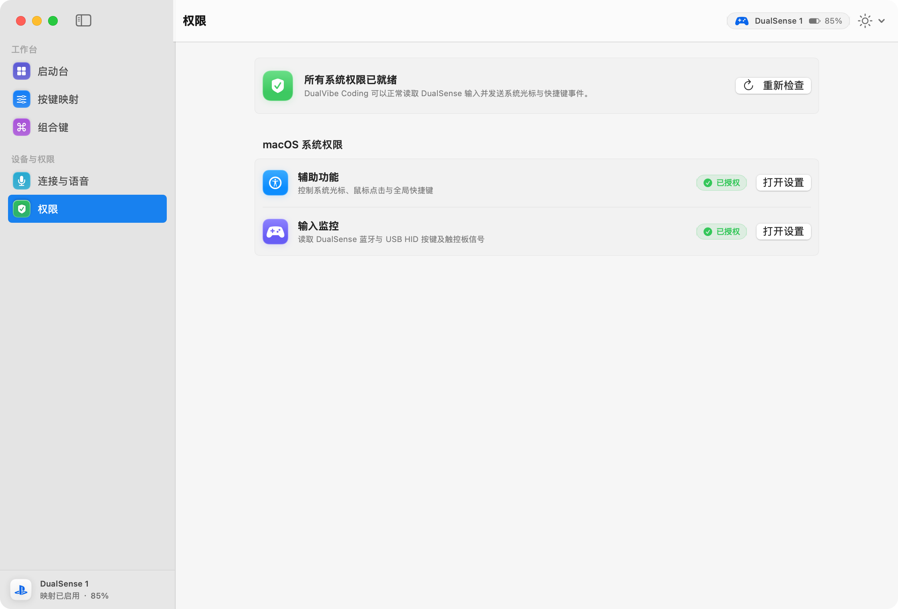

# DualVibe Coding

[English](README.en.md)

[下载 DMG](https://github.com/ruaomol/DualVibe-Coding/releases) · [AI 一键安装](docs/guides/AI-INSTALL.md) · [问题反馈](https://github.com/ruaomol/DualVibe-Coding/issues)

<p>
  <a href="https://github.com/ruaomol/DualVibe-Coding/releases"></a>
  <a href="LICENSE"></a>
  <a href="https://github.com/ruaomol/DualVibe-Coding/stargazers"></a>
</p>

## 视频介绍

24 秒短片，直观展示 DualVibe Coding 如何把 PlayStation DualSense 变成随手操控 Mac、自由切换应用与流畅 Vibe Coding 的全新入口。

<p align="center">
  <a href="docs/assets/video/dualvibe-promo.mp4">
    
  </a>
</p>

<p align="center">
  <a href="docs/assets/video/dualvibe-promo.mp4">点击封面观看完整视频</a>
</p>

<p align="center">
  
</p>

**DualVibe Coding，Mac 好搭子，Coding 好帮手，操作更顺手。**

**随手掌控，随心主动。你的下一个 Coding 设备，何必是键鼠。**

<p align="center">
  
</p>

DualVibe Coding 是一款为 macOS 原生打造的 DualSense 控制器应用，可以把 PS5 手柄变成鼠标、键盘、语音麦克风与八向应用启动器。它先让手柄输入开箱即用，再把触控板手势、全键位映射、组合键、快捷轮盘以及每个 App 自己的方案自然连在一起。

DualVibe Coding 使用 SwiftUI 与 AppKit 原生开发，完整适配 macOS 原生控件与浅色、深色及跟随系统外观；支持蓝牙或 USB 同时连接多只 DualSense，顶部状态栏与侧边栏一眼可见当前设备、电量和充电状态。

## DualVibe Coding，Mac 好搭子

### 一套手柄，串起完整工作流

连接手柄，选择映射，呼出轮盘，执行操作。DualVibe Coding 把按键、摇杆、触控板、麦克风和应用启动收进同一套工作流。

<p align="center">
  
</p>

### 触控板当鼠标

移动、单击、双击、右键、拖拽、滚动，还可以直接双指左右滑动切换桌面。摇杆可以持续模拟输出，和按键同时按住时，拖拽和快捷键依然稳定不打断。

<p align="center">
  
</p>

### 按键随你改

打开「按键映射」并启用自定义映射后，可随时切换手柄正面与背面 3D 视角，点击图示或列表直接编辑任意按键动作：

- 每个按键支持分别配置 **单击、双击与长按** 动作，也支持配置「同时按住」修饰键形成组合触发；
- 支持映射为鼠标单击/双击/长按/按住拖拽、任意键盘快捷键（内置左右 `Shift` / `Control` / `Option` / `Command` / `Fn` 独立修饰键选择）、打开指定 App、切换桌面、命令面板、终端或呼出快捷轮盘；
- 支持按下实体手柄直接录入按键与修饰键，每个 App 都能拥有独立映射方案，冲突会在对应位置直接标出。

<p align="center">
  
</p>

### 轮盘一键开

按下 `PS` 键即可在屏幕中心或鼠标附近唤出八向快捷轮盘，推左/右摇杆或按方向键即可顺滑选定目标，确认键一键执行。每个方向都可自由配置为打开应用、运行组合键、执行快捷键或开关麦克风。

<p align="center">
  
</p>

### 应用随手拖

把常用 `.app` 直接从访达拖进应用库，集中管理常用软件。在同一页即可完成搜索、排序、一键启动，以及为单个 App 开启独立映射或切回全局映射。

<p align="center">
  
</p>

### 蓝牙语音与多手柄管理

「连接与语音」集中管理所有已连接的蓝牙与 USB DualSense 设备，支持多手柄快速切换、实时电量与充电状态显示、系统与手柄麦克风输入切换、输入电平测试，以及光标与滚动灵敏度精细调节。

<p align="center">
  
</p>

## 需要什么

- macOS 14 或更高版本；
- DualSense 手柄（蓝牙无线或 USB-C 有线）；
- 使用鼠标、键盘、触控板或快捷键时，请在系统设置里打开 **辅助功能** 与 **输入监控**；
- 使用语音输入或测试麦克风电平时，打开 **麦克风** 权限。

## AI 一键安装（Agent 提示词）

不熟悉 macOS 设置也可以：把下面这段提示词整段复制给豆包、DeepSeek、Claude 等 AI 助手，它会先检查你的 Mac 环境，再一步步带你完成下载安装、蓝牙配对、系统权限授权与输入验证。完整说明见 [docs/guides/AI-INSTALL.md](docs/guides/AI-INSTALL.md)。

<details>
<summary><strong>点开复制「DualVibe Coding 一键安装」提示词</strong></summary>

```text
你是我的 macOS 安装向导。请用简单中文，少用术语。你的目标是帮我安装并验证 DualVibe Coding，让 DualSense 可以控制 Mac 的鼠标、键盘、触控板手势、快捷键和应用启动，并让语音输入真正出字。

开始前先说明你的能力。如果你只能聊天，不要假装执行命令，只告诉我每一步点哪里、输入什么，然后等我回复结果。如果你能操作这台 Mac，也必须在每个会改变系统或安装软件的步骤前说明目的，遇到系统权限、安装器确认和蓝牙配对时停下来让我本人确认。

产品事实：
- DualVibe Coding 只支持 macOS，最低 macOS 14。
- 支持 Sony DualSense 手柄通过 Bluetooth 或 USB 连接，支持多手柄切换并显示电量与充电状态。
- 安装包名称为 DualVibe-Coding-版本.dmg，打开后将 DualVibe Coding.app 拖入 Applications。
- 应用内可选择 Mac 系统麦克风，也可按需选择 DualSense 麦克风。
- 官方下载入口：https://github.com/ruaomol/DualVibe-Coding/releases。打不开时停止操作并告诉我，不要从不明来源下载。
- 不要让我关闭 Gatekeeper、防火墙或任何系统安全设置。

请按顺序推进，每一步确认结果后再进入下一步：
1. 检查 Mac 芯片类型、macOS 版本（≥14）、蓝牙开关与手柄电量。
2. 从官方 Releases 下载 DMG，把 DualVibe Coding.app 拖入 Applications 并从 Applications 启动。
3. 由我本人通过 USB 或“系统设置 → 蓝牙”（长按 Create + PS 键进入配对）连接 DualSense，在“连接与语音”确认识别。
4. 打开左侧“权限”页，由我本人在系统设置中开启“辅助功能”与“输入监控”，授权后重启应用并点击“重新检查”。
5. 在“连接与语音”中确认系统输入麦克风并测试电平。
6. 在“按键映射”与“启动台”中验证触控板鼠标、按键快捷键与八向快捷轮盘。
7. 在普通文本框中完成一次实际输入验证，并汇报最终就绪状态。
```

</details>

## 下载与安装

当前版本 [DualVibe Coding v0.1.0](https://github.com/ruaomol/DualVibe-Coding/releases/tag/v0.1.0) 提供 `DualVibe-Coding-0.1.0.dmg`。下载后打开磁盘映像，把 `DualVibe Coding.app` 拖进「应用程序」。首次打开时进入「权限」页，按提示完成系统授权，再点「重新检查」。

<details>
<summary><strong>展开查看首次启动与权限步骤</strong></summary>

1. 打开应用的「权限」页，查看辅助功能、输入监控状态。
2. 点击缺失权限旁边的「打开设置」，按 macOS 系统设置中的提示完成授权。
3. 授权完成后退出并重新打开 DualVibe Coding，点击「重新检查」，确认状态变为「已授权」。
4. 如果只使用按键映射，授予辅助功能和输入监控即可；需要使用语音输入时，再开启麦克风权限。

</details>

<p align="center">
  
</p>

## 从源码构建

```sh
brew install opus
./scripts/build-app.sh
./scripts/package-dmg.sh
```

构建结果只会放在本地的 `.build/` 和 `dist/` 里。`scripts/package-dmg.sh` 会在 `dist/` 生成 `DualVibe-Coding-版本.dmg`。应用使用固定的 Bundle Identifier 和持久化本地签名身份，升级之后 macOS 已授予的辅助功能权限可以继续生效。演示步骤见 [docs/guides/DEMO.md](docs/guides/DEMO.md)。

## 隐私与开源说明

DualVibe Coding 完全在本地运行，不上传你的按键映射、应用列表、语音内容或蓝牙设备标识。仓库只包含源代码、构建脚本、必要第三方声明和公开文档。

项目在开发过程中参考了以下开源项目的思路：

- [Agent Remote](https://github.com/AbhisekBasu1/agent-remote)：DualSense 输入解析与触控板思路；
- [remote-mic-app（无线麦 SayAll）](https://github.com/HD838A/remote-mic-app)：macOS 蓝牙麦克风方案与文档排版参考；
- [StarPie](https://github.com/Star-Pie/StarPie)：手柄快捷轮盘交互思路。

## ⭐ Star History

<p align="center">
  <a href="https://github.com/ruaomol/DualVibe-Coding/stargazers">
    
  </a>
</p>

## 许可证

DualVibe Coding 使用 [MIT License](LICENSE)。第三方组件的许可证和声明会随应用一起打包，也保存在 `ThirdParty/AgentRemote`。

## 交流群

有问题，或者想聊聊 DualSense × Vibe Coding 的键位玩法，欢迎扫码加入 DualVibe Coding 交流群。

<table>
  <tr>
    <td align="center">
      <a href="docs/assets/community/dualvibe-coding-group.jpg"></a><br>
      <strong>DualVibe Coding 交流群</strong><br>
      微信扫码加入交流
    </td>
  </tr>
</table>
