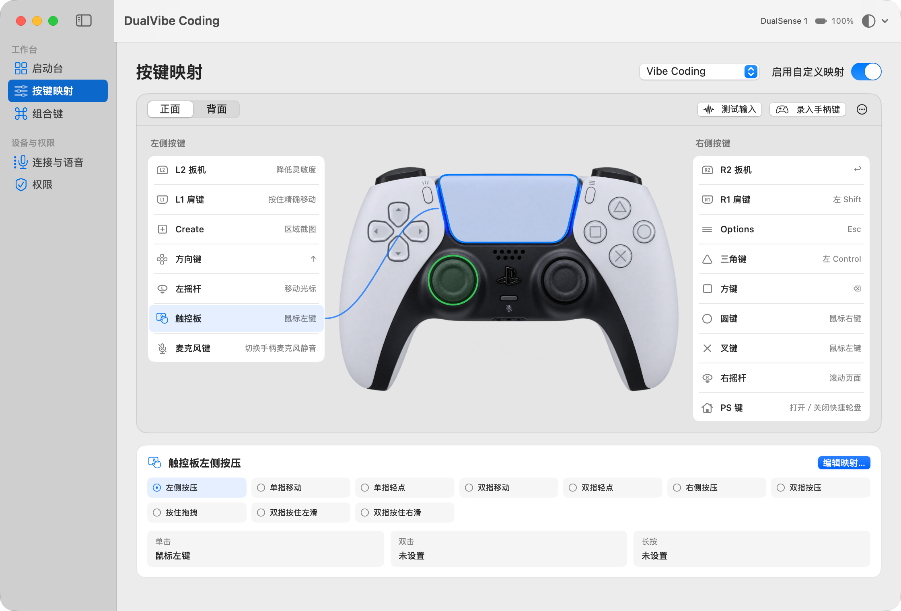
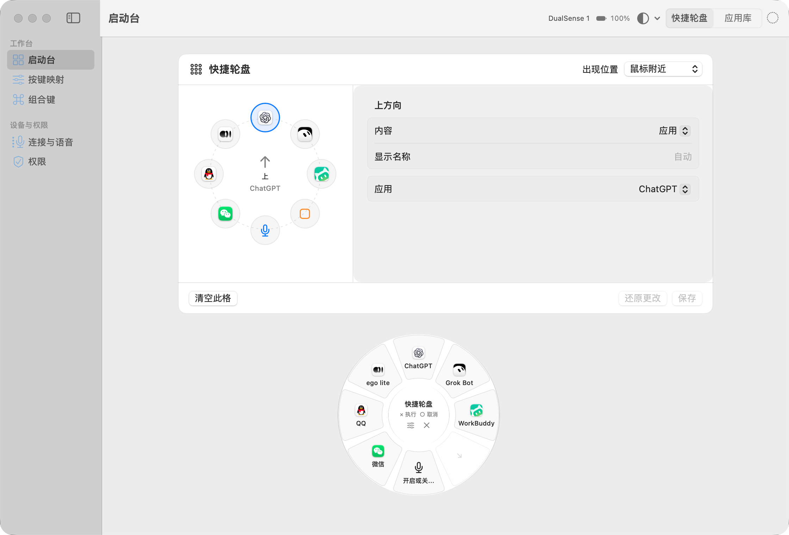
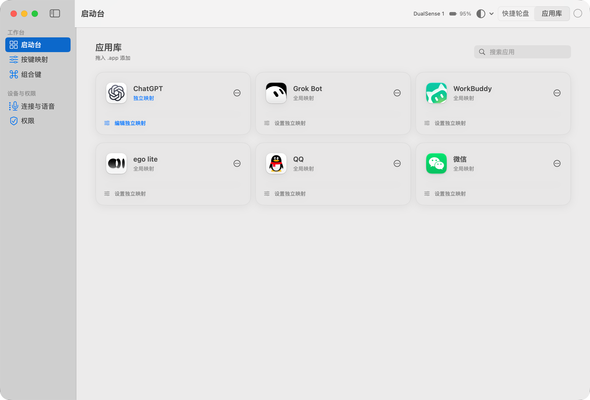

# DualVibe Coding

[English](README.en.md)

<p align="center">
  <a href="https://github.com/ruaomol/DualVibe-Coding/releases"></a>
  <a href="https://github.com/ruaomol/DualVibe-Coding"></a>
  <a href="LICENSE"></a>
  <a href="https://github.com/ruaomol/DualVibe-Coding/stargazers"></a>
</p>

<p align="center">
  <a href="https://github.com/ruaomol/DualVibe-Coding/releases">下载 DMG</a> ·
  <a href="https://github.com/ruaomol/DualVibe-Coding/issues">问题反馈</a>
</p>

<h2 align="center">DualVibe Coding，Mac 好搭子，Coding 好帮手，操作更顺手。</h2>

<p align="center">
  
</p>

**随手掌控，随心主动。你的下一个 coding 设备，何必是键鼠。**

DualVibe Coding 是一款 macOS 应用，可以把 DualSense 变成鼠标、键盘、麦克风和启动器。它先让手柄输入马上能用，再把触控板手势、按键映射、快捷轮盘，以及每个 App 自己的方案连在一起。

DualVibe Coding 使用 SwiftUI 原生开发，支持蓝牙或 USB 同时连接多个 DualSense，电量和充电状态一眼能看到。

<p align="center">
  
</p>

## DualVibe Coding，Mac 好搭子

### 一套手柄，串起完整工作流

连接手柄，选择映射，呼出轮盘，执行操作。DualVibe Coding 把按键、摇杆、触控板、麦克风和应用启动收进同一套工作流。

<p align="center">
  
</p>

### 触控板当鼠标

移动、单击、双击、右键、拖拽、滚动，还可以切桌面。摇杆可以持续输出，和按键一起用，拖拽、按住会更稳。

<p align="center">
  
</p>

### 按键随你改

把按键映射成键盘、鼠标单击、双击、长按，或一套快捷键。每个 App 都能有自己的一套映射，冲突会标在对应位置上。

<p align="center">
  
</p>

### 轮盘一键开

快捷轮盘能打开应用、跑组合键或执行映射动作，用方向键或摇杆就能选。应用库支持直接从访达把 `.app` 拖进来。

也支持浅色、深色，或跟随系统。窗口重新激活后，状态会自动恢复。

<p align="center">
  
</p>

### 应用随手拖

把常用 `.app` 拖进应用库，集中管理应用。每个 App 可以使用独立映射，也可以沿用全局映射。搜索、添加和编辑都在同一页完成。

<p align="center">
  
</p>

## 需要什么

- macOS 14 或更高版本
- DualSense 手柄
- 要用鼠标、键盘、触控板或快捷键时，请在系统设置里打开辅助功能和输入监控
- 要用语音输入时，打开麦克风权限

## 下载与安装

当前版本 [DualVibe Coding v0.1.0](https://github.com/ruaomol/DualVibe-Coding/releases/tag/v0.1.0) 提供 `DualVibe-Coding-0.1.0.dmg`。下载后打开磁盘映像，把 DualVibe Coding.app 拖进「应用程序」。首次打开时进入「权限」页，按提示完成系统授权，再点「重新检查」。

<details>
<summary><strong>展开查看首次启动与权限步骤</strong></summary>

1. 打开应用的「权限」页，查看辅助功能、输入监控和麦克风状态。
2. 点击缺失权限旁边的按钮，按 macOS 系统设置中的提示完成授权。
3. 返回 DualVibe Coding，点击「重新检查」，确认状态变为已授权。
4. 如果只使用按键映射，可以先授予辅助功能和输入监控。使用语音输入时，再打开麦克风权限。

</details>

<p align="center">
  
</p>

## 从源码构建

```sh
brew install opus
./scripts/build-app.sh
./scripts/package-dmg.sh
```

构建结果只会放在本地的 `.build/` 和 `dist/` 里。`scripts/package-dmg.sh` 会在 `dist/` 生成 `DualVibe-Coding-版本.dmg`，发布时将它上传到 GitHub Releases。应用使用固定的 Bundle Identifier 和长期有效的签名身份，所以升级之后，macOS 的辅助功能授权还可以继续用。

## 隐私与开源说明

这个仓库只放源代码、构建脚本、必要的第三方声明和公开文档。你的个人映射、应用路径、签名密钥、构建缓存，以及过程中的截图和测试记录，都不会上传。

项目里参考了 [Agent Remote](https://github.com/AbhisekBasu1/agent-remote) 的 DualSense 输入和触控板思路、[remote-mic-app](https://github.com/HD838A/remote-mic-app) 的麦克风方案，还有 [StarPie](https://github.com/Star-Pie/StarPie) 的手柄轮盘交互。

## 许可证

DualVibe Coding 使用 [MIT License](LICENSE)。第三方组件的许可证和声明会随应用一起打包，也保存在 `ThirdParty/AgentRemote`。

## 交流群

有问题，或者想聊聊用法，欢迎加入 DualVibe Coding 交流群。

<p align="center">
  
</p>
